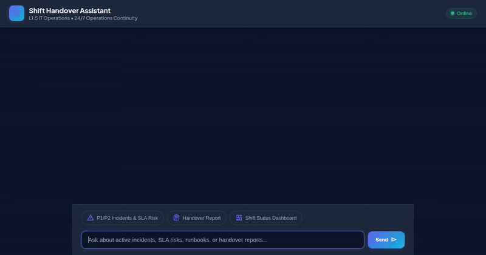

# 🚀 L1.5 IT Operations Shift Handover Assistant

An intelligent, interactive agent built on Google Agent Development Kit (ADK) and A2UI to streamline 24/7 IT Application Operations shift transitions.



---

## 🎯 Overview

The Shift Handover Assistant automates complex IT operations handovers between outgoing and incoming engineering teams. It retrieves real-time operational incident reports, calculates SLA breach risks, searches runbooks, tracks pending action items, and generates visual handover reports backed by persistent memory.

---

## 🛠️ Integrated Google Cloud Services & Technologies

This repository implements the following Google Cloud services and ADK framework capabilities:

- 🧠 Vertex AI Memory Bank: Persists structured shift handover summary records across shifts so incoming leads have complete historical context.
- 🔥 Google Cloud Firestore: Stores and queries active P1, P2, P3, and P4 operational incident reports and shift history records.
- 🗄️ Google Cloud Storage: Hosts generated visual shift summary dashboard assets with public HTTP access.
- 🎨 Google GenAI Imagen 3: Dynamically generates visual system status and SLA heatmaps (imagen-3.0-generate-002).
- 🎛️ A2UI (Agent to UI): Renders interactive cards, headers, metadata rows, and visual assets directly in the chat UI.
- 🧪 Agent Engine Sandbox Code Executor: Executes python data processing scripts safely in remote sandboxed environments.

---

## 🔧 Agent Tools Reference

The agent exposes the following python tools defined in app/agent.py:

1. get_active_incidents(severity_filter): Retrieves active incident reports filtered by severity level with SLA breach deadlines.
2. search_runbooks(query): Searches Standard Operating Procedure (SOP) runbooks for mitigation steps.
3. get_pending_actions(filter_owner): Lists pending action items left for incoming shift leads.
4. search_shift_history(query): Filters past shift logs across a 30-day date range with natural language date parsing.
5. create_handover_report(shift_name, outgoing_lead, incoming_lead, active_incidents_summary, key_blockers, notes): Generates a structured handover report and saves it to Vertex AI Memory Bank.
6. generate_shift_dashboard_image(service_name): Generates a visual status dashboard image using Imagen and uploads it to Google Cloud Storage.

---

## 💻 Local Setup & Execution Guide

Follow these commands to run the application locally on your workstation:

### 1. Prerequisites
- Python 3.10+
- Google Cloud SDK (gcloud CLI)
- Active GCP Project with Application Default Credentials (ADC)

### 2. Environment Setup
```bash
git clone <your-repo-url>
cd shift-handover-agent
uv sync
```

### 3. Set Environment Variables
```bash
export GOOGLE_CLOUD_PROJECT="<your-gcp-project-id>"
export AGENT_ENGINE_RESOURCE_NAME="projects/<project-number>/locations/us-east1/reasoningEngines/<engine-id>"
export AGENT_DIRECTORY="app"
```

### 4. Run Local Development Server
```bash
cd frontend
python main.py
```

### 5. Deploy Agent to Vertex AI Agent Runtime
```bash
agents-cli deploy --no-confirm-project --project <your-gcp-project-id>
```
